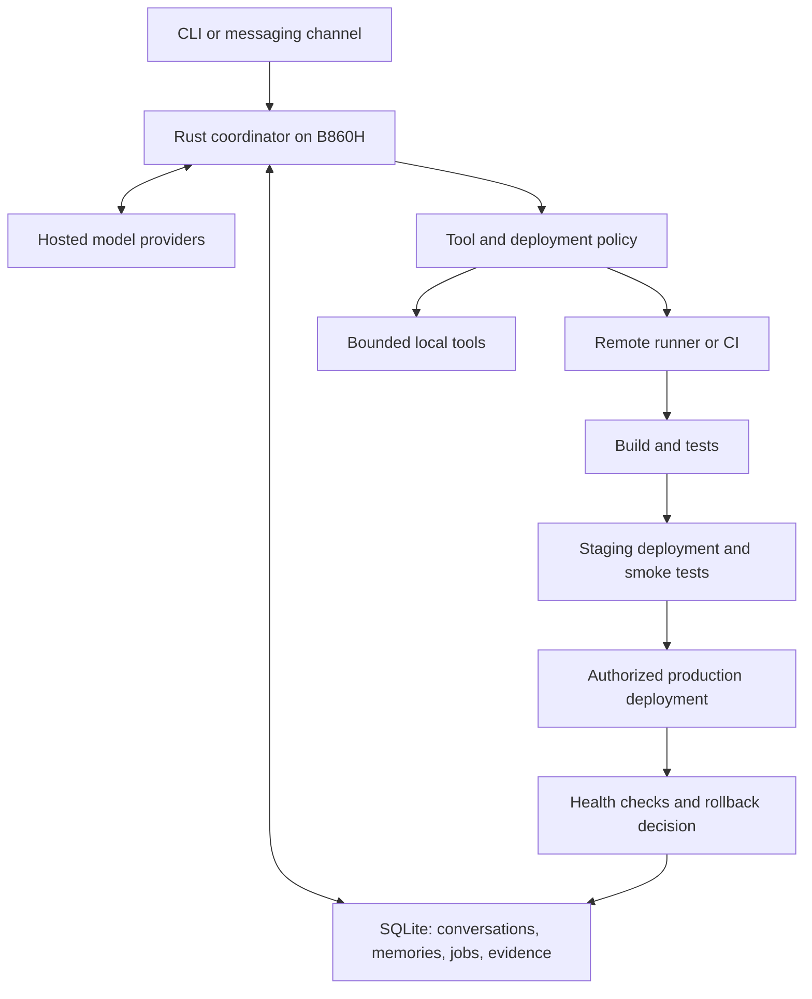

# Mornye: research and proposed design

Research date: 2026-10-17. This document records the original design proposal; at research time the repository contained a Rust Hello World program. See the root README for current implementation status and remaining gaps. Resource targets below are not hardware measurements.

## Target and recommendation

User hardware: B860H set-top box, four ARM cores, 2 GB RAM, 128 GB microSD. Models will run through hosted providers, primarily DeepSeek, potentially ChatGPT plan access, Gemini, or OpenCode services. Subsequent device inspection confirmed 64-bit aarch64 Armbian on Ubuntu 24.04; see validation-armbian.md. Board revision and available remote build infrastructure remain unconfirmed.

Build a small Rust coordinator that owns conversations, memory, jobs, permissions, and progress. Use remote execution for expensive builds, browser tests, and deployment tooling. Small local tasks can run within measured limits. Port selected behavior rather than translating entire upstream applications.

Evaluate ZeroClaw before committing to a new runtime: its repository already describes a single Rust binary with provider, channel, tool, and SQLite memory components. Whether extending it is cheaper than maintaining a focused Mornye implementation requires a pinned-source review and a hardware benchmark. No upstream RAM claims have been independently verified here. [ZeroClaw](https://github.com/zeroclaw-labs/zeroclaw)

## Features to adapt

| Reference | Documented capability | Proposed Mornye adaptation |
| --- | --- | --- |
| Hermes | Reusable skills learned from tasks, session recall, scheduling, multiple execution backends | Version learned procedures and link them to recorded outcomes; evaluate changes before promotion |
| OpenClaw | Gateway for channels, sessions, tools, and events | One small daemon; CLI plus one messaging channel first |
| OpenClaw workspace | Separate persona, identity, and user preference files | User-editable personality with stable core traits and bounded preference updates |
| mem0 | Extracted memories, scoped retrieval, configurable storage and inference | Rust memory interface; local SQLite implementation initially, optional remote mem0 adapter |
| Graphify | AST-derived code graph, explained edges, graph traversal | Incremental code graph with file hashes, revision tracking, and extracted/inferred labels |

Sources: [Hermes](https://github.com/NousResearch/hermes-agent), [OpenClaw](https://github.com/openclaw/openclaw), [workspace](https://docs.openclaw.ai/concepts/agent-workspace), [mem0 overview](https://docs.mem0.ai/open-source/overview), [memory insertion](https://docs.mem0.ai/core-concepts/memory-operations/add), [Graphify](https://github.com/Graphify-Labs/graphify).

These are implementation priorities for this hardware, not claims that upstream projects lack equivalent features. Before copying actual source, pin a revision, inspect applicable file licenses and dependencies, and preserve required notices. A Rust rewrite is not automatically API-compatible with the original.

## Runtime layout

Candidate Rust components: Tokio for async orchestration, reqwest/rustls for HTTP, serde for typed messages, rusqlite for persisted state, tracing for diagnostics, and tree-sitter for selected language parsers. These are candidates to validate on the actual target, not a finalized dependency list. Keep blocking database/indexing work away from the async request path.

Define provider, channel, memory, executor, and deployment interfaces. Preserve provider-specific continuation fields; a common endpoint shape does not guarantee identical tool-call behavior. Add protocol fixtures for streaming interruption, invalid arguments, multiple tool calls, and retries.

## Providers and subscriptions

- DeepSeek: first direct API adapter. Its documentation describes tool calls; verify the chosen model's reasoning and history requirements during implementation. [DeepSeek](https://api-docs.deepseek.com/guides/tool_calls/)
- Gemini: separate adapter with native function-call semantics. [Gemini](https://ai.google.dev/gemini-api/docs/function-calling/)
- ChatGPT: official documentation now describes Sign in with ChatGPT for eligible open-source applications and eligible Plus/Pro users, including permission to use plan allowances. Implement the documented OAuth flow and verify account eligibility; do not assume generic API keys receive subscription billing. [Official integration guide](https://developers.openai.com/cookbook/articles/sign-in-with-chatgpt)
- That ChatGPT route has preview restrictions: streaming, client-managed history, and restricted parameters/tools. Build a capability-aware adapter and handle quota exhaustion explicitly. Documentation establishes a supported integration route, not a guarantee that this particular application/account is eligible. [Preview limitations](https://developers.openai.com/siwc/token-sharing-open-source/preview-limitations)
- OpenCode is also a coding harness, not just a model. Its documentation describes provider integrations and its Go service. Distinguish an optional OpenCode executor from a direct hosted inference adapter. [Providers](https://docs.opencode.ai/docs/providers/)

Make models configurable. Do not silently switch to a paid provider after subscription exhaustion; configure that fallback and a spend cap. Always-on means listening continuously, not generating continuously.

## Three memory systems plus personality

1. Personal memory: explicit preferences, projects, recurring facts, and dated corrections. Store source message, owner/scope, confidence, timestamps, expiry, and supersession. User corrections win over inferred preferences. Support inspect, edit, forget, and export.
2. Code knowledge: files, symbols, imports, references, tests, and deployment targets. Record repository revision and source location. Reindex changed files and invalidate dependent edges. AST extraction does not prove complete call resolution in dynamic or macro-heavy code; preserve uncertainty and fall back to source search.
3. Procedural memory: versioned skills with prerequisites, tools required, verification steps, observed successes/failures, and rollback notes.

Keep the conversation log separately. A summary is a retrieval aid, not the sole record. Start with SQLite full-text search and bounded retrieval. Add embeddings only after measuring missed paraphrase queries; optionally use remote embeddings or mem0 without running its full service stack on the box.

Graphify's code extraction and mem0's personal memory serve different purposes. For the first version, optionally generate Graphify output remotely and import it with schema/version checks. Later, implement a focused Rust indexer for Rust and TypeScript. Do not attempt all languages or document/media ingestion initially.

Personality can live in SOUL.md and IDENTITY.md, while preferences live in structured memory. Give Mornye a consistent tone, humor, initiative, and communication style. Allow it to learn that the user prefers short replies; do not let retrieved text rewrite its permissions or core identity. Preserve personality across model switches with a small regression conversation set.

## Coding and deployment with evidence

Persist a job state machine: queued, inspecting, editing, testing, staging, verifying, deploying, observing, completed; with failed, cancelled, and needs-input outcomes.

Each job records repository revision, workspace, patch hash, commands, exit codes, test results, artifact digest, deployment ID, and health-check observations. Reports distinguish planned, attempted, passed, failed, and unverified. Never label a deployment successful just because its command started.

Use isolated workspaces and keep chat responsive while jobs execute. Bind test results to the exact patch/artifact; subsequent edits invalidate relevant verification. A second model may review a diff, but is not a substitute for tests. Prevent the agent from treating removal of a failing test as proof of a fix.

Remote server flow: build immutable artifact, deploy to staging, run smoke checks, promote within configured authorization, monitor, and restore the previous artifact if appropriate. Use a restricted execution identity, pinned SSH host identity, timeouts, and separate deployment credentials.

Cloudflare flow: run project tests and Workers runtime tests on the remote runner/CI, deploy to a staging environment, verify routes and bindings, then promote and record the deployed version. Cloudflare documents Workers Vitest integration and integration test tooling. [Testing](https://developers.cloudflare.com/workers/testing/) [CI/CD](https://developers.cloudflare.com/workers/ci-cd/)

Record rollback eligibility before deployment. Worker code rollback does not undo application data mutations; schema and data changes need a separate recovery plan. [Worker rollbacks](https://developers.cloudflare.com/workers/versions-and-deployments/rollbacks/)

Production authorization should be scoped by project, environment, operation, and budget. Standing permission can cover routine deployments; ask only when the action exceeds that scope. Retrieved documents and skills cannot grant permission.

## Self-improvement

After a meaningful completed task or diagnosed failure, create a candidate lesson. Compare it with existing skills, attach evidence, test on representative cases, then promote or discard it. Track successful reuse, regressions, tool calls, elapsed time, and token cost. Keep previous versions for rollback. Limit reflection work by schedule and budget.

Distinguish three changes: memory updates, skill updates, and executable updates. Automatic memory/skill updates may be allowed within configured boundaries. Executable changes must use a branch, remote build, regression tests, a trial installation, and recoverable update mechanism. The running agent cannot modify its own authorization rules. This is procedural improvement; it does not train hosted model weights.

## Resource and reliability targets

Initial engineering targets, not measurements:

| Workload | Target |
| --- | --- |
| Idle coordinator RSS | Below 100 MiB |
| Active chat and bounded retrieval RSS | Below 250 MiB |
| Local service plus child processes | Initial 512 MiB ceiling if OS supports enforcement |
| Local heavy jobs | One at a time; prefer remote execution |
| Idle model usage | No recurring inference without a scheduled purpose |

Account for kernel/page cache, OS services, child processes, and provider adapters separately. Test with sustained activity on the actual device. A larger microSD increases capacity, not RAM or flash endurance.

Use bounded channels and logs, backoff with jitter, cancellation, storage quotas, and a durable queue. For microSD: batch noncritical logs, cap retention, checkpoint SQLite deliberately, and back up off-device. Persist critical job transitions durably before acknowledging them; do not trade away correctness merely to reduce writes.

On Linux, use the available service manager for restart and boot startup. After restart, reconcile in-flight remote jobs and deployments before retrying. Use operation IDs and idempotency where supported; do not promise exactly-once external effects. When offline, retain jobs and show unavailable status instead of pretending to continue inference.

## Build sequence and acceptance criteria

1. Hardware/runtime spike: confirm OS/ABI, benchmark a minimal coordinator and ZeroClaw on identical workloads, choose reuse or new core. Measure RSS, CPU, startup, temperature, and disk writes.
2. Conversation foundation: DeepSeek streaming, CLI plus one chat channel, durable history, personality, tool validation, cancellation. Must survive restart and reject unauthorized tool calls.
3. Memory and jobs: scoped personal memory, full-text retrieval, persisted scheduling, progress notifications, quota limits. Test correction/forgetting and duplicate delivery.
4. Coding execution: isolated remote workspace, patching, real test results, interrupted-job recovery. Demonstrate a bug fix whose tests fail before and pass after.
5. Deployment: one remote server and one Worker example; staging checks, explicit deployment evidence, and rollback exercise. Test lost connection after deployment submission.
6. Graph and learning: incremental code index, candidate skills, held-out evaluations, version rollback. Compare retrieval and task completion against a simple search baseline.
7. Soak test: at least seven days with network outages, provider rate limits, process restarts, and near-full storage. Verify memory remains bounded and no deployment is duplicated.

Open decisions: OS and 32/64-bit userspace; remote runner availability; first messaging channel; model budgets; production deployment scope. Research is complete enough to choose this architecture, but hardware performance, code reuse suitability, and account eligibility remain unverified.
